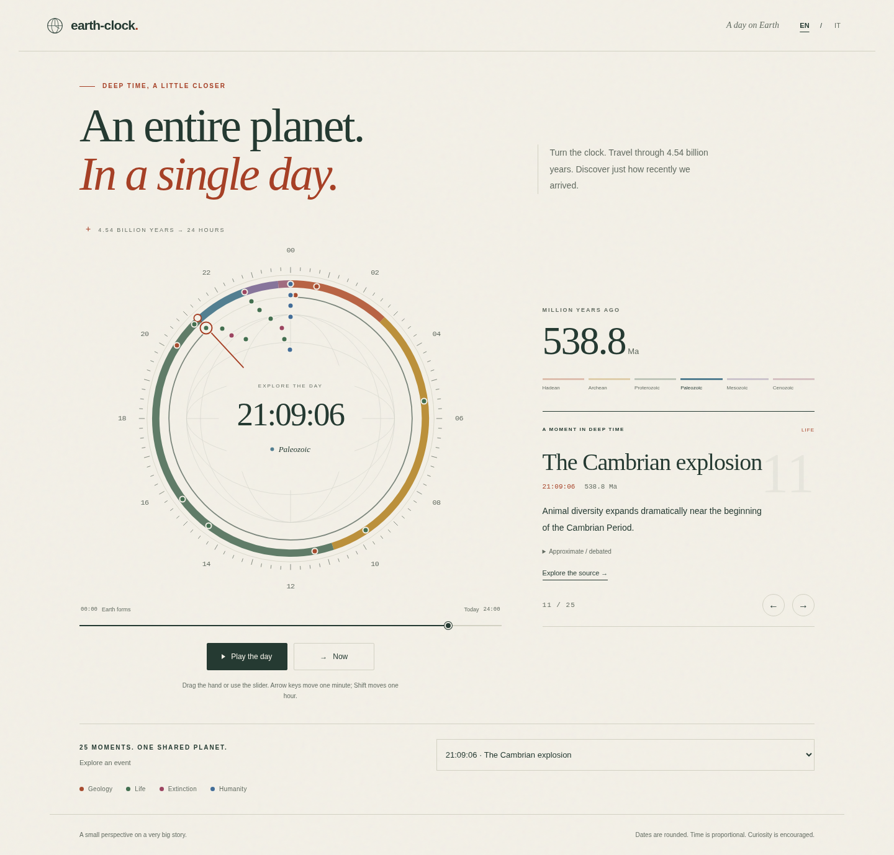

# earth-clock

Earth’s 4.54 billion years, compressed into a single 24-hour day.
Drag the hand, follow 25 moments in deep time, and find our species in the final **5.71 seconds**.
A small, dependency-free static page with English and Italian UI, light/dark themes, and iframe support.



## Run locally

**No installation or build is required.** Open `index.html` in a modern browser.
Keep the folder intact: the page loads its local CSS and a committed standalone JavaScript fallback.

Alternatively, serve the folder using Python:

```sh
cd /path/to/Earth-Clock
python3 -m http.server 8000
```

Visit `http://localhost:8000`. HTTP hosting uses native ES modules.
Node is only needed for tests and refreshing the standalone fallback after editing JavaScript.
No package installation is needed; there are no third-party dependencies or remote fonts.

## Explore

- Drag anywhere on the dial outside its center, or use the slider.
- Focus the slider: arrow keys move one minute, Shift + arrow moves one hour; Home/End select the endpoints.
- Click a marker, choose an event in the menu, or use the card’s previous/next buttons.
- **Play the day** takes about 90 seconds of travel, plus 1.8-second pauses at each event.
- **Now** selects Homo sapiens and explains the scale of human history.
- Reduced-motion mode replaces continuous playback with discrete steps, stopping at intervening events.
- Language follows the browser unless overridden; the language toggle changes all event text.

Geological colors indicate six broad intervals. Hadean, Archean and Proterozoic are eons;
Paleozoic, Mesozoic and Cenozoic are eras. They are grouped for a readable overview.
Markers retain their true angular time; clustered markers move inward for easier selection.
The event menu provides an accessible alternative to the crowded final seconds.

## Embed

Replace the URL below with your deployed page. The iframe contains its own controls and styles:

```html
<iframe
  src="https://marcoitaly27.github.io/Earth-Clock/?embed=1&lang=en&theme=light&t=21:00"
  title="Earth’s history in one day"
  width="100%"
  height="980"
  style="border:0; max-width:1100px"
  loading="lazy">
</iframe>
```

Use a taller iframe (about 1400–1600px) on narrow screens, or allow its internal scrolling.
There is no cross-origin auto-height script.

| Parameter | Values | Behavior |
| --- | --- | --- |
| `embed` | `1` | Hides the site header, introduction and footer |
| `lang` | `it`, `en` | Overrides browser language |
| `theme` | `dark`, `light` | Overrides system theme |
| `t` | `HH:MM` (also `HH:MM:SS`) | Sets the initial clock position, including `24:00` |

Invalid parameters fall back to defaults. The initial event card shows the most recent event
at or before the chosen time; it stays there while you explore between events.

## Data and sources

`data/events.js` exports 25 bilingual, sourced events. Each source is a real Wikipedia article
linked from its event card, with references for further reading. These are educational,
rounded milestones, not precise measurements of instantaneous global changes.
The app never contacts source sites automatically.

Important uncertainties include lunar formation, early water and life, oxygenic photosynthesis,
eukaryotes, multicellularity, early animals, and the origins of major biological groups.
Each uncertain event includes bilingual notes. The Great Oxidation and Cambrian radiation
unfolded over long intervals. Agriculture arose independently in multiple places.
The Industrial Revolution is conventionally placed around 1760 CE; its age is rounded relative
to 2026 and does not update every year. Boundary dates are also rounded and may be revised.

The full-precision conversion is:

```text
seconds since midnight = (1 − mya / 4540) × 86400
```

The clock rounds to the nearest second for display, including carrying into `24:00:00`.
Agriculture and industry both round to `24:00:00`; their exact age and selection remain distinct.
Fractional seconds are retained internally, so playback still stops at every event.
“Humans” in the Now caption specifically means **Homo sapiens**, not the earlier genus Homo.

## Add or update an event

Edit `data/events.js`, keeping the events in descending `mya` order. Use a unique `id`,
`name_it`, `name_en`, `mya`, `category` (`geology`, `life`, `extinction`, `humans`),
`description_it`, `description_en`, and an authoritative HTTPS `source` URL.
The helper constructs these objects; optional final arguments add bilingual uncertainty notes.
For debated dates, include `uncertain: true`, `note_it` and `note_en` when writing a literal object.
Never enter clock times: they are calculated from the age.
Update the bilingual moment count and dataset-size assertion if you add or remove events.

After changing JavaScript modules:

```sh
node scripts/standalone.js
node --test
```

This refreshes the committed file-URL fallback. It is a maintenance step for contributors,
not a build step for users or deployment. The test suite detects a stale fallback.

## Tests

Node 20+; CI uses Node 22. Run from the repository root:

```sh
node --test
```

Tests cover endpoints, nine known ages, all event round trips, 1001 sampled times,
invalid inputs, rounding carry, URL parsing, pointer angles, geological boundaries,
event playback ordering, data shape and standalone fallback parity.
GitHub Actions runs them on every push and pull request.

Browser validation also exercised marker selection, drag, keyboard, playback pauses,
Now, both languages, URL parameters, reduced motion and 320–1440px layouts in Chromium.
The managed browser blocks `file://` navigation; the exact standalone fallback was exercised
over HTTP instead. Direct-file behavior should also be checked in your own browser.

## Publish with GitHub Pages

1. Commit and push these files to the repository’s `main` branch.
2. In GitHub, open **Settings → Pages**.
3. Select **Deploy from a branch**, branch **main**, folder **/ (root)**, then **Save**.
4. Wait for the Pages deployment to finish. GitHub will show the published address.

No Pages build workflow is needed. `.nojekyll` keeps this a plain static site.
The URL shown in the embed example is the expected project address, not a claim of deployment.

## Structure

- `index.html`, `styles/`: accessible markup and responsive presentation.
- `src/time.js`: pure conversion, formatting and pointer math.
- `src/eras.js`, `src/dial.js`, `src/playback.js`: intervals, dial geometry and event crossings.
- `src/app.js`, `src/ui.js`, `src/copy.js`: interaction, rendering and interface translations.
- `src/boot.js`, `standalone.js`: HTTP module loader and local-file fallback.
- `data/events.js`: sourced bilingual history.
- `tests/`, `docs/decisions.md`, `AGENTS.md`: validation and maintenance guidance.
